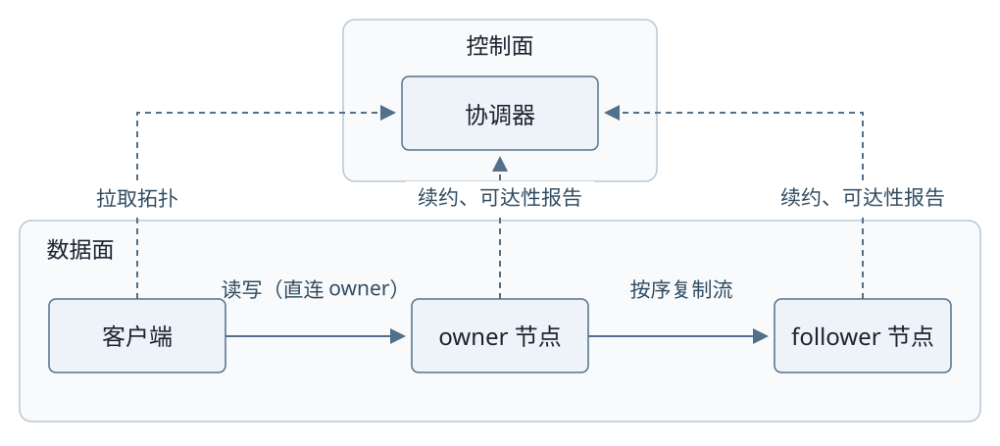

## 一、问题分析

### 1.1 要解决的问题

单机内存缓存结构简单、延迟低，但随着业务规模增长，会面临以下三方面的限制：

- **容量与吞吐。** 单台机器的内存和处理能力存在上限，无法随业务量线性扩展。
- **可用性。** 缓存进程崩溃后，其数据立即不可访问；重启后需从空状态重新预热，期间请求将直接落到后端存储，可能导致后端过载。
- **扩缩容代价。** 若用 $h(\text{key}) \bmod N$ 分片，节点数一旦变化，绝大多数键的归属都会改变，扩缩容几乎等同于缓存整体失效。

由于缓存数据可由后端重新生成，缓存无需承担磁盘持久化、事务和强一致多副本协议的开销；但它同样不应因单个节点故障而整体不可用。

本项目的目标是实现一个**多进程的分布式内存缓存**：数据按一致性哈希分布于多个节点，并支持在线扩缩容；每段数据保存多个副本，节点故障时自动转移；写入确认的严格程度作为可配置的集群策略，由使用者在写入延迟与故障时的数据保留之间权衡。

### 1.2 应用场景

- 作为业务系统的缓存层，存放会话、对象元数据、聚合查询结果等可由后端重建的热点数据；
- 在负载随时间变化时按需增减节点，扩缩容期间服务不中断；
- 单个节点崩溃后自动进行故障转移，读取在数秒内恢复，写入按所选确认策略恢复；
- 节点之间仅通过带版本的 gRPC 接口通信，同一客户端既可连接本机多进程集群，也可连接容器或远程主机上的集群。

### 1.3 相关技术调研 {#sec-related-work}

本项目主要参照 Redis Cluster、Apache Cassandra 与 ScyllaDB。Redis Cluster 是分布式缓存的直接参照；后两者虽为数据库，但其 token 环与本项目的技术路线最为接近。

**数据分布。** 采用取模分片时，节点数从 $N$ 变为 $N+1$ 会使约 $\frac{N}{N+1}$ 的键更换节点，因此工业系统普遍在键与节点之间引入一层逻辑分片。Redis Cluster 将键空间固定划分为 16384 个 hash slot，扩缩容时仅修改 slot 到节点的映射（[Redis Cluster Specification](https://redis.io/docs/latest/operate/oss_and_stack/reference/cluster-spec/)）。Cassandra 采用一致性哈希环，每个物理节点持有多个 token，增删节点只影响相邻区间（[Cassandra: Dynamo](https://cassandra.apache.org/doc/latest/cassandra/architecture/dynamo.html)）。ScyllaDB 的 tablets 则允许每个分片独立迁移与分裂（[ScyllaDB: Tablets](https://docs.scylladb.com/manual/stable/architecture/tablets.html)）。

**路由与拓扑管理。** 请求可经代理转发（如 Twemproxy），可发往任意节点后由其转发（Cassandra），也可由客户端缓存映射后直接发往目标节点（Redis Cluster，映射过时时返回 `MOVED`）。Redis Cluster 与 Cassandra 依靠 gossip 传播拓扑，难以保证所有节点以相同顺序观察到变更；ScyllaDB 已改用 Raft 定序（[ScyllaDB: Raft](https://docs.scylladb.com/manual/stable/architecture/raft.html)），Cassandra 的 [CEP-21](https://cwiki.apache.org/confluence/display/CASSANDRA/CEP-21:+Transactional+Cluster+Metadata) 也在向这一方向演进。拓扑变更频率低且要求严格有序，适合集中定序，前提是控制面不进入读写路径。

**在线迁移。** 在线迁移的难点在于复制期间的新写入以及切换时刻的处理。Redis 传统上借助 `MIGRATING`/`IMPORTING` 状态与 `ASK` 重定向逐批迁移键；Redis 8.4 的原子 slot 迁移则改为先发送快照、再同步增量，最后短暂暂停写入并完成切换（[Atomic slot migration](https://redis.io/blog/atomic-slot-migration/)）。

**复制与故障恢复。** Redis Cluster 采用主从复制：每个 slot 由一个 master 和若干 replica 负责，master 故障后由 replica 经选举接替。复制是异步的，若 master 已确认写入而 replica 尚未收到时发生故障，该写入即会丢失；`WAIT` 虽能让 master 等待若干 replica 确认，却无法消除这一窗口，因为故障后被选中的 replica 未必是已确认的那一个（[WAIT](https://redis.io/docs/latest/commands/wait/)）。Cassandra 与 ScyllaDB 采用无主 quorum：写入达到 quorum 即确认，单副本故障无需切换，代价是副本可能暂时不一致，需依靠时间戳裁决冲突，再由 hinted handoff 和 repair 补齐（[ScyllaDB: Fault Tolerance](https://docs.scylladb.com/manual/stable/architecture/architecture-fault-tolerance.html)）。主从路线还需防止旧 owner 在被取代后继续服务（即脑裂）：epoch 用于拒绝持有旧拓扑的客户端，租约用于阻止未察觉自身已被取代的旧 owner。

### 1.4 技术选型与设计目标

数据分布采用带虚拟节点的一致性哈希。在此基础上，主要的设计选择如下：

1. **单实例协调器集中定序，辅以租约。** 协调器串行执行拓扑变更，租约保证同一时刻至多存在一个有效 owner（[3.4 节](#sec-failover)），数据节点之间无需运行共识协议。
2. **客户端路由。** 客户端缓存协调器下发的拓扑（含 epoch 与全部 token 分配）并直接访问 owner，读写不增加额外跳数，协调器也不位于读写路径上。
3. **采用快照加增量迁移，而非双写。** 双写会将迁移逻辑引入正常写路径；快照加增量仅在切换时对迁移中的区间短暂停写。
4. **采用单 owner 主从复制与具名确认策略，而非无主 quorum。** 唯一的 owner 使写入顺序、去重和迁移切换都易于定义。`FirstSuccessor` 策略要求故障时将被提升的副本先行确认，从而消除了 `WAIT` 无法消除的丢失窗口（[3.2.2 节](#sec-replication)）。
5. **副本沿环放置，放置规则即接管计划。** 某节点被移除后，新 owner 恰为原先的第一个 follower（[3.2.1 节](#sec-successor)），因此缩容与故障转移无需搬运整段数据，也无需选举。
6. **依据覆盖证明提升副本，而非选择“最新”的副本。** 按滞后程度或版本选择副本，一旦选错便会静默丢失数据；只认可协调器记录的覆盖证明，可将此类错误转化为显式的不可用。

### 1.5 项目范围与规模 {#sec-scope}

本项目实现了一致性哈希路由、可配置的多副本与写入确认策略、在线扩缩容、故障自动转移与修复、请求去重，以及多进程实验运行器和兼容 Redis 协议的网关（详见[第三章](#sec-ch-design)）。以下内容不在本项目范围内：磁盘持久化、协调器自身的高可用、按请求覆盖集群级确认策略，以及 Redis 的数据结构命令。

系统采用 Rust 实现，共分为七个 crate，各自职责见[表 1-1](#tbl-crates)。

Table: 表 1-1　crate 划分与职责 {#tbl-crates}

| crate | 职责 |
| --- | --- |
| `hashring-core` | protobuf 协议、拓扑与迁移的领域类型、协议上限 |
| `hashring-client` | 路由、截止时间、重试与错误语义 |
| `hashring-coordinator` | 持久化集群状态与变更编排 |
| `hashring-node` | 内存记录、复制流、迁移暂存与数据节点服务 |
| `hashring-experiment` | 真实多进程实验与证据记录 |
| `hashring-redis` | Redis 协议网关 |
| `hashring-redis-lua-experimental` | 网关上的实验性 Lua 脚本支持 |

## 二、算法理论基础 {#sec-ch-theory}

### 2.1 一致性哈希与迁移量 {#sec-migration-rate}

一致性哈希将键与 token 映射到同一个环上，新增节点仅从后继节点处接管其 token 所覆盖的区间。若各节点份额相同，扩容时新节点接管约 $\frac{1}{N+1}$ 的键；删除一个节点时，迁移量等于该节点的环份额，约为 $\frac{1}{N}$。

以 $N=10$ 为例，取模分片约有 90.9% 的键需要迁移；而在一致性哈希下，10→11 扩容的预期迁移率约为 9.1%，10→9 缩容约为 10%。实测 10→11 扩容的迁移率为 6.45%，11→10 缩容同为 6.45%（移除的正是刚加入的节点），10→9 缩容为 10.51%。实测值围绕理论值波动，原因在于迁移量等于变更节点的实际环份额，而该份额由 token 的随机位置决定（[2.2 节](#sec-vnode)）。

### 2.2 虚拟节点与均衡度 {#sec-vnode}

每个物理节点持有 $V$ 个随机放置的 token，其份额为 $V$ 段随机弧长之和，各节点份额的变异系数近似为

$$\mathrm{CV} \approx \frac{1}{\sqrt{V}}.$$

$V$ 越大，分布越均衡，但 $V$ 每增加一倍，CV 仅降低约 29%。[表 2-1](#tbl-cv) 比较了理论 CV 与按各节点拥有键数算出的实测 CV。

Table: 表 2-1　理论 CV 与实测 CV（10 节点、10 万键、seed 1） {#tbl-cv}

| $V$ | 理论 CV | 理论 ±1 标准误差 | 实测 CV |
| ---: | ---: | ---: | ---: |
| 16 | 0.250 | 0.191–0.309 | 0.178 |
| 64 | 0.125 | 0.096–0.154 | 0.139 |
| 128 | 0.088 | 0.068–0.109 | 0.088 |
| 200 | 0.071 | 0.054–0.087 | 0.062 |
| 256 | 0.063 | 0.048–0.077 | 0.048 |

$V=200$ 时另以 seed 2、3 各测一次，CV 分别为 0.066 和 0.081。增大 $V$ 的代价见 [8.1 节](#sec-balance)。

## 三、软件功能分析与设计 {#sec-ch-design}

### 3.1 总体架构

系统由客户端、数据节点和协调器三种角色组成，分为数据面与控制面，如[图 3-1](#fig-architecture) 所示。

{#fig-architecture width=86%}

**数据面**仅包含客户端和数据节点。客户端缓存协调器下发的拓扑，自行计算键的 owner 并直接发送请求；owner 在内存中应用写入后，按序复制给 follower。follower 只接收复制，不处理普通读请求。

**控制面**由单实例协调器构成。它串行执行所有拓扑变更，向节点发放租约，记录各副本的就绪状态，并在节点故障时安排接管。协调器不处理读写请求。协调器不可用时，节点在租约有效期内照常服务，租约到期后自行停止服务。因此，协调器故障的后果是服务停止，而非在错误的拓扑下继续服务。

### 3.2 数据分布与副本机制

#### 3.2.1 区间与接管者 {#sec-successor}

键经哈希映射到环上。每个物理节点在环上持有 $V$ 个 token（默认 128），每个 token 负责其与前一个 token 之间的区间。拓扑由协调器整体下发，并带有单调递增的 epoch，因此所有客户端和节点计算出的环完全一致。区间没有固定编号：加入节点会切分区间，删除节点会合并区间。

区间的副本列表直接由环推导：从区间的 owner 出发沿顺时针方向，依次收集尚未出现的物理节点，直至数量达到复制因子 RF（默认 3）。owner 之后的节点依次为第一个、第二个 follower。系统不单独维护副本放置表。

由此可得整个设计中最重要的性质：**区间的第一个 follower，恰为 owner 被移除后环所选出的新 owner。** 二者都是“从该区间出发沿顺时针方向、跳过原 owner 后遇到的第一个节点”。

{#fig-ring-example width=94%}

如[图 3-2](#fig-ring-example) 所示，移除节点 A 之前，区间 (10, 20] 与 (20, 25] 的副本均为 A、B、C；移除之后，二者与 (25, 40] 合并为 (10, 40]，副本变为 B、C、D，原先的第一个 follower B 成为 owner。

一般而言，移除一个节点只会使每个副本列表删去该节点、其余节点依次前移一位，并在末尾补入一个新节点。前移的节点原本就持有数据，缺少数据的只有末尾新补入的节点。因此，缩容和故障转移都无需在关键路径上搬运整段数据，接管者也无需选举产生。虚拟节点使一个节点的区间分散在环上各处，该节点离开后，其负载分散到多个后继节点，而不会集中于单个相邻节点。

#### 3.2.2 副本就绪与写入确认 {#sec-replication}

环只确定接管者是谁，并不保证接管者的数据完整：follower 可能刚刚加入、初始复制尚未完成，也可能经历过复制中断。因此系统区分以下两个概念：

- **期望副本**：副本应位于何处，由拓扑决定；
- **已准入副本**：副本是否已经就绪。follower 的初始快照及其后的连续增量均通过校验后，协调器才会为其写入一条**准入记录**。

只有已准入的 follower 才能计入写入确认，或在故障时被提升。

**写入过程。** owner 首先检查自身确为该键的 owner、epoch 与客户端一致且租约有效，随后在本地应用写入，再通过按序复制流发送给全部期望 follower。owner 只需等待确认策略所要求的 follower 应用完成即返回成功，其余复制在后台继续进行。

**确认策略。** 确认策略决定 owner 何时向客户端返回成功。无论采用哪种策略，写入都会复制给全部期望 follower，策略只决定 owner 在回复前需要等待哪些副本应用完成。等待的副本越多，写入延迟越高，但 owner 崩溃时，已确认的写入已存在于接管者上的可能性也越大。确认策略是集群级配置，共有三个选项，见[表 3-1](#tbl-ack-policies)。

Table: 表 3-1　三种写入确认策略 {#tbl-ack-policies}

| 策略 | 何时确认写入 | 故障时的数据保留 |
| --- | --- | --- |
| `OwnerOnly`（默认） | owner 已应用 | owner 崩溃时，尚未复制到接管者的写入将会丢失 |
| `FirstSuccessor` | owner 和第一个 follower 均已应用 | 从健康状态出发，单节点故障不会丢失已确认的写入 |
| `AllReplicas` | 全部期望副本均已应用 | 副本不足时写入失败，可重试 |

### 3.3 在线扩缩容

管理员提交目标成员列表，协调器将其持久保存后串行执行，同一时间只执行一个变更。每次变更都会发布一个新 epoch。客户端以旧 epoch 发出的请求会被拒绝，客户端刷新拓扑后重试，因此变更对使用者透明。

**扩容**需要将数据复制到新节点，采用快照加增量的方式：

1. 源节点导出受影响区间的快照，同时继续作为 owner 处理读写，迁移期间的新写入记入变更日志；
2. 目标节点导入快照，再按顺序回放日志；
3. 切换时，仅正在迁移的区间短暂停写（客户端收到可重试的错误），读取不受影响。协调器排空剩余日志，校验两端数据一致后发布新拓扑，最后清理源节点上的旧副本。

**缩容**利用 [3.2.1 节](#sec-successor)所述的性质：离开节点的区间并入原先的第一个 follower，而该 follower 已持有相应数据，因此只需变更归属，无需复制数据。协调器确认所有接管者均已准入后，短暂停写以等待复制追平，再发布新拓扑。副本列表末尾新补入的 follower 通过后台修复获取数据。

### 3.4 故障检测、转移与修复 {#sec-failover}

**租约。** 协调器为每个节点发放 5 秒租约，节点约每秒续约一次。读写均要求节点持有有效租约，无法续约的节点会自行停止服务。租约保证同一时刻每个区间至多只有一个有效 owner，节点之间无需运行共识协议。节点每次启动都作为新的实例，重启后内存为空的进程不能沿用旧身份，从而避免将“数据丢失”误报为“键不存在”返回给客户端。

**故障确认。** 节点之间相互探测，并将结果报告给协调器。若目标节点的租约已经失效，协调器直接确认故障；否则，需要至少两个独立节点持续报告其不可达满 5 秒。若仅有一对节点彼此不可达，协调器无法判断问题出在哪一方，只将其标记为疑似故障，不驱逐任何一方。

**接管。** 故障确认后，接管按以下步骤进行：

1. 协调器停止为故障节点续约，并等待其租约确定过期，以保证旧 owner 不会与新 owner 同时服务；
2. 协调器检查**覆盖证明**：每个区间的新 owner 要么原本就是 owner，要么是已准入的第一个 follower。只要有一处不满足，协调器便不发布新拓扑，相关区间保持不可用。系统宁可显式不可用，也不提升数据不完整的副本；
3. 协调器发布不含故障节点的新拓扑，新 owner 立即以已有数据恢复读取；
4. 写入按确认策略恢复：`OwnerOnly` 立即恢复，`FirstSuccessor` 需等待新的第一个 follower 修复完成，`AllReplicas` 需等待全部副本就绪。

故障节点即使重新启动，也只能以新成员身份加入，并像新节点一样完成复制与校验。

**副本修复**负责将副本数补回 RF。修复目标直接由拓扑确定：协调器令当前 owner 向缺少准入记录的 follower 发送快照与增量，校验通过后写入准入记录。修复不改变 epoch，对客户端不可见。

### 3.5 请求去重 {#sec-dedup}

网络中断时，客户端无法得知一次写入是否已经执行，只能重试；若重试导致写入再次执行，就可能覆盖其他客户端在此期间写入的值。为此，客户端为每次逻辑写入生成一个 mutation ID，所有重试均携带同一 ID。owner 执行写入后保留去重收据 60 秒，再次收到同一 ID 时直接返回原结果。收据随复制流发送给 follower，迁移时随快照传给新 owner，因此迁移之后的重试同样能够去重。

### 3.6 Redis 网关 {#sec-gateway}

系统自带的客户端库只能嵌入 Rust 程序，而大量现有应用和工具（`redis-cli`、redis-py、Jedis 等）使用 Redis 协议。为使这些应用无需修改代码即可接入本系统，我们实现了 Redis 网关，对外提供兼容 Redis 协议的 TCP 服务。从 Redis 客户端的角度看，网关与一台单机 Redis 无异。

网关支持的命令见[表 3-2](#tbl-gateway-commands)。

Table: 表 3-2　网关支持的命令 {#tbl-gateway-commands}

| 类别 | 命令 |
| --- | --- |
| 连接与管理 | `PING`、`HELLO`（RESP2 与 RESP3）、`AUTH`、`SELECT 0`、`CLIENT`、`INFO`、`CONFIG` 等 |
| 字符串 | `GET`、`SET`（含 `NX`/`XX`/`GET`/过期选项）、`GETRANGE`、`SETRANGE`、`APPEND`、`STRLEN`、`MGET`、`MSET`、`INCR` 系列等 |
| 键与过期 | `DEL`、`EXISTS`、`TYPE`、`RENAME`、`EXPIRE` 系列、`TTL`、`PERSIST` 等 |
| 键空间 | `KEYS`、`SCAN`、`DBSIZE`、`RANDOMKEY` |

### 3.7 实验运行器 {#sec-runner}

分布式缓存的许多问题只会在真实进程与真实计时下出现，例如节点被终止时尚在传输中的复制、租约到期前后的读写，以及迁移切换瞬间的重试。单元测试无法覆盖这些情况，而手工启动多个进程进行实验又难以复现。实验运行器正是为解决这一问题而设计：通过一条命令，即可在单台主机上启动协调器和若干真实的数据节点进程，经客户端库施加负载，在负载期间执行扩缩容或终止节点，最后校验每个键的结果。

运行器提供六种模式，见[表 3-3](#tbl-runner-modes)。

Table: 表 3-3　实验运行器模式 {#tbl-runner-modes}

| 模式 | 针对的问题 |
| --- | --- |
| `correctness` | 扩缩容期间并发写入与删除，结束后每个键是否正确 |
| `performance` | 百万键规模下的写入与读取吞吐 |
| `availability` | 节点故障后的恢复时间，以及连续故障后副本能否补齐 |
| `latency` | 开环负载下各目标速率对应的延迟，以及过载发生的位置 |
| `scaling` | 持续负载下扩缩容对请求的影响 |
| `fault` | 负载期间丢失 follower 或 owner 时，已确认的写入是否得以保留 |

实验运行器简化了在不同配置下搭建环境、执行运行、调优参数和收集证据的过程。

### 3.8 可视化看板

<!-- TODO（陈阳）：本节约半页，写完后删除本注释。需要补充：
1. 用途：看板展示什么，面向谁（运维观察集群状态、演示故障转移与扩缩容）。
2. 数据来源：读取哪些接口或文件（例如 `topology`、`replica-status`、`change-status` 的输出，或实验运行器的 `events.jsonl`），以及刷新方式（轮询间隔或回放）。
3. 图 3-3：看板总览截图，放在 docs/report/assets/，图注写在 alt 文本里，格式：
   {#fig-dashboard width=86%}
4. 第六章引用的三组证据图（owner 故障转移、9→10 扩容、$V=1$ 与 $V=128$ 的均衡度对比）由第六章引用，不在本节重复。
这一节不要写看板没有实现的功能。 -->

## 四、数据结构分析与设计

本项目使用的主要数据结构有四种：哈希环、记录表及其 token 索引、复制流队列以及去重收据存储。

### 4.1 环：排序的 token 数组

环是一个按 token 升序排列的数组，每个元素记录一个 token 及其所属节点，其上的两种操作见[表 4-1](#tbl-ring-ops)。

Table: 表 4-1　环上的操作 {#tbl-ring-ops}

| 操作 | 实现 | 复杂度 |
| --- | --- | --- |
| 键到 owner | 对键计算 64 位哈希值，二分查找第一个不小于该值的 token；若越过末尾，则回绕至首元素 | $O(\log T)$ |
| 区间的副本列表 | 从 owner 位置沿顺时针方向遍历，跳过已收集的物理节点，直至收集到复制因子个节点 | 最坏 $O(T)$，通常只需遍历少数几步 |

$T$ 为环上的 token 总数，10 节点、每节点 128 个 token 时 $T=1{,}280$。环仅在拓扑变更时整体替换，其余时间只读，因此采用有序数组而非平衡树：二者的查找复杂度均为对数级，但数组内存连续，缓存局部性更好，且无需维护树的平衡。

### 4.2 记录表与 token 索引 {#sec-token-index}

数据节点将 owner 与 follower 的记录存放在同一张哈希表中，每条记录保存值、版本、墓碑标记和过期时间。

迁移需要取出落在某个 token 区间内的全部键，而哈希表无法支持这一操作，因此节点另外维护一个按 token 排序的有序映射，用于由 token 查找对应的键；过期清理则借助一个按过期时间排序的索引。三种结构各自支持的操作见[表 4-2](#tbl-record-index-ops)。

Table: 表 4-2　记录表与索引支持的操作 {#tbl-record-index-ops}

| 操作 | 结构 | 复杂度 |
| --- | --- | --- |
| 读写单个键 | 哈希表 | 平均 $O(1)$ |
| 取某个 token 区间内的全部键 | token 索引 | $O(\log n + k)$，$k$ 为区间内键数 |
| 找出已过期的记录 | 过期索引 | $O(\log n + e)$，$e$ 为过期数 |

$n$ 为节点上的记录数。键的 token 仅取决于键本身，与拓扑无关，因此扩缩容和故障转移时均无需重建 token 索引。

### 4.3 复制流队列

owner 为每个 follower 维护一条按序复制流。每条流是一个有界队列（默认容量为 32 个条目），由一个投递任务将排队条目合并成批发送。节点上所有流共享 64 MiB 的待复制字节预算，两项上限共同保证积压始终有界。

### 4.4 去重收据存储

收据存储由按 mutation ID 查找的哈希表和按过期时间排序的堆组成，清理时只处理已到期的收据；此外还维护一个与记录表相同的 token 索引，使迁移时只需取出区间内的收据。存储总量受字节预算限制，默认为 128 MiB。

## 五、算法优化 {#sec-ch-optimization}

### 5.1 实验环境与工具

实验负载由[实验运行器](#sec-runner)生成。驱动程序、协调器与全部数据节点部署于同一主机，经回环网络通信。性能分析采用四类数据：以 `perf` 采样生成的 CPU 火焰图、写路径各阶段的耗时计数器、状态写锁的等待与持有时间统计，以及 RPC 延迟直方图，分别用于定位计算热点、写入开销、锁竞争与通信开销。

实验使用两台主机，配置见[表 5-1](#tbl-hosts)。

Table: 表 5-1　实验主机 {#tbl-hosts}

| 主机 | CPU | 系统 |
| --- | --- | --- |
| 桌面主机 | AMD Ryzen 9 7845HX，24 逻辑 CPU | Linux |
| 笔记本 | Apple M1 Pro，8 逻辑 CPU，16 GiB 内存 | macOS |

### 5.2 迁移区间索引

原先的记录表不记录键的 token，每次提取迁移区间都要将节点上的全部键重新哈希后再过滤，且多数扫描在持有状态锁期间进行。火焰图显示，这类全量扫描约占一次扩缩容全过程 CPU 周期的 60%。

改进方案是引入 [4.2 节](#sec-token-index)所述的 token 索引，使区间提取变为有序映射上的范围查询，复杂度从 $O(n)$ 降至 $O(\log n + k)$；去重收据也建立了同样的索引。改动前后的对照见[表 5-2](#tbl-token-index)。

Table: 表 5-2　token 索引改动前后（8 节点、10 万键的正确性实验，三组运行的中位数） {#tbl-token-index}

| 指标 | 改动前 | 改动后 |
| --- | ---: | ---: |
| 扩容期间的变更速率 | 174 次/秒 | 1,694 次/秒（9.8 倍） |
| 区间提取占 CPU 周期 | 60.7% | 5.6% |
| 整个实验耗时 | 88.5 s | 31.7 s |
| 节点峰值内存（RSS） | 473 MiB | 68.7 MiB |

代价是每次写入需额外执行一次索引插入，稳态内存略有增加，初始写入吞吐未出现退化。

### 5.3 路由与收据清理

通过写路径耗时计数器分析 10 节点、百万键的写入实验，发现两处多余开销：客户端每次请求前都先复制完整的环（1,280 个 token）再选择 owner；节点每秒清理确认进度时，即使所有复制流均属于当前 epoch，也会扫描全部去重收据。

改进后，客户端直接在已缓存的拓扑上查找目标节点，不再复制环；进度清理仅在存在旧 epoch 的复制流时才扫描收据。改动前后的对照见[表 5-3](#tbl-routing-cleanup)。

Table: 表 5-3　路由与收据清理改动前后（10 节点、100 万键、`OwnerOnly`，三组运行的中位数） {#tbl-routing-cleanup}

| 版本 | 写入耗时 | 读取校验耗时 |
| --- | ---: | ---: |
| 改动前 | 78.2 s | 56.0 s |
| 改动后 | 54.5 s | 17.0 s |

### 5.4 复制批量 {#sec-replication-batching}

RPC 延迟直方图与火焰图显示，请求约 90% 的延迟花在处理函数之外，节点约 70%–80% 的 CPU 时间消耗在 gRPC 协议栈与套接字系统调用上。而优化前每条复制流一次只发送一个条目并等待确认，复制 RPC 的数量随写入数线性增长。

首先改为批量发送：投递任务将队列中连续的条目合并为一次复制 RPC，follower 一次应用整批条目。但一批只能包含上一次 RPC 在途期间排入的条目，批通常很小。为此引入短暂等待（linger）：若某条流上没有等待确认的写入且批未满，则最多再等待 2 毫秒以收集更多条目；一旦有写入在等待确认，立即发送。对照结果见[表 5-4](#tbl-replication-batching)。

Table: 表 5-4　复制批量等待的对照（6 节点、30 万键、$\mathrm{RF}=3$、并发 64） {#tbl-replication-batching}

| 策略 | 等待 | 写入吞吐 | 每批条目数 | 复制 RPC 数 |
| --- | --- | ---: | ---: | ---: |
| `OwnerOnly` | 0 | 37,246 次/秒 | 2.2 | 276,634 |
| | 2 ms | 50,273 次/秒（+35%） | 11.1 | 54,198 |
| `FirstSuccessor` | 0 | 30,079 次/秒 | 1.7 | 359,606 |
| | 2 ms | 35,928 次/秒（+19%） | 2.5 | 235,311 |

等待时间再延长收益有限，而较短的等待能使 `OwnerOnly` 的丢失窗口更小，经过参数扫描后选择 2 毫秒作为默认值。

## 六、测试 {#sec-ch-testing}

### 6.1 测试方法与环境 {#sec-test-method}

### 6.2 功能正确性 {#sec-test-correctness}

### 6.3 在线扩缩容 {#sec-test-scaling}

### 6.4 故障转移与数据保留 {#sec-test-failover}

### 6.5 负载均衡 {#sec-test-balance}

### 6.6 性能与延迟 {#sec-test-performance}

### 6.7 Redis 网关兼容性 {#sec-test-gateway}

### 6.8 测试的局限 {#sec-test-limits}

## 七、总结

本项目实现了多进程分布式内存缓存 hashring-rs：数据按一致性哈希分布在多个节点上，支持在线扩缩容、多副本和故障自动转移，现有 Redis 应用可通过网关直接接入。

整个设计围绕三个思路展开。第一，控制面不进入读写路径：读写只发生在客户端与数据节点之间，单实例协调器只负责给拓扑变更定序。第二，副本放置规则本身就是接管计划：节点离开后，环选出的新 owner 恰好是原先的第一个副本，因此只有扩容需要复制数据，缩容与故障转移既不搬运数据，也不需要选举。第三，正确性优先于可用性：故障时只提升确认数据完整的副本，宁可显式不可用，也不静默丢失数据；在此前提下，写入确认的严格程度作为集群策略开放给使用者，在写入延迟与故障时的数据保留之间权衡。

单机多进程实验表明，扩缩容的迁移量符合一致性哈希的理论预期；单节点故障后，读取约 5 秒恢复；采用 `FirstSuccessor` 策略时，全部故障实验均未丢失已确认的写入。

目前系统的局限在于：尚未实现拓扑推送；协调器不具备高可用；所有实验均在单台主机上完成。

## 八、扩展与展望 {#sec-ch-outlook}

### 8.1 改进数据放置的均衡性 {#sec-balance}

节点份额的 CV 约为 $1/\sqrt{V}$（[2.2 节](#sec-vnode)），10→9 缩容的迁移率（10.51%）和连续故障后的均衡度（默认 $V$ 下极差为 10.5–31.2%）均受此影响。增大 $V$ 的代价很高：$V=1024$ 时，连续故障后的极差降至 3.1–6.3%，但替换节点的初始复制时间从 2.8–4.0 秒增至 87–117 秒；$V=2000$ 时，协调器内存达到 5.2 GB，一次 10→11 变更在 380 秒内未能完成发布。更可取的方向是改进放置策略，例如采用有界负载的一致性哈希或按容量放置，但新策略必须保持“第一个 follower 即接管者”这一规则（[3.2.1 节](#sec-successor)）。

### 8.2 拓扑元数据的推送

客户端目前在请求出错后才拉取新拓扑，另以 5 秒轮询兜底。推送即协调器发布 epoch 时经长连接主动通知客户端，这一方法可以免去先失败再刷新的一轮重试。

### 8.3 协调器的高可用

协调器故障时，节点因无法续约而停止服务。可将协调器状态复制到多个实例，并以 Raft 为拓扑变更定序；这一改动仅涉及控制面，不进入读写路径。

### 8.4 多机部署

所有实验均在单台主机的回环网络上完成，负载生成器与全部进程共享 CPU。下一步可在多台机器上重复关键实验，测量真实的横向扩展能力，并检验真实网络环境下故障检测与租约的行为。

### 8.5 Redis 网关

网关是集中的争用点，增加网关数量可以提高吞吐上限。后续工作包括针对真实 `redis-server` 进行逐命令的差异测试，以及在网关层实现连接复用和请求批量处理。

## 九、AI 辅助说明

<!-- 待补充 -->

## 附录

### A：复现命令

所有实验均通过 `hashring-rs experiment` 子命令运行，输出目录必须为新建目录或空目录。完整参数可通过 `hashring-rs experiment --help` 查看，各项内容的入口见[表 A-1](#tbl-repro-commands)。

Table: 表 A-1　复现命令 {#tbl-repro-commands}

| 内容 | 命令或入口 |
| --- | --- |
| 正确性与迁移（9→10→9） | `hashring-rs experiment --mode correctness --output <dir>` |
| 百万键性能 | `hashring-rs experiment --mode performance --output <dir>` |
| 故障转移与连续故障 | `hashring-rs experiment --mode availability --availability-rounds 3 --output <dir>` |
| 开环延迟 | `hashring-rs experiment --mode latency --target-rates <rates> --output <dir>` |
| 持续负载下的扩缩容 | `hashring-rs experiment --mode scaling --output <dir>`；正式矩阵用 `scripts/scaling-matrix.sh` |
| 负载中的 follower 或 owner 丢失 | `hashring-rs experiment --mode fault --fault-scenario <scenario> --output <dir>`，`<scenario>` 为 `follower` 或 `owner` |
| 单次性能运行并采样 CPU 与 RPC | `scripts/perf/run.sh`，结果汇总用 `scripts/perf/collect.py` |
| 写锁与 RPC 剖析 | 设置环境变量 `HASHRING_PROFILE_WRITES=1`、`HASHRING_PROFILE_RPC=1` |
| Redis 网关 | `hashring-rs redis-gateway --listen 127.0.0.1:6379 --coordinator <coordinator-addr>`，例如 `http://127.0.0.1:50050` |
| 构建本报告的 PDF | 在 `docs/report/` 下运行 `make pdf INPUT=final-report.md` |

### B：项目目录结构

仓库是一个 Cargo 工作区：根目录的二进制包提供命令行入口，七个 crate 位于 `crates/` 下，各自职责见 [1.5 节](#sec-scope)。下面的目录树仅列出主要路径。

```text
hashring-rs/
├── src/
│   ├── main.rs                 # 命令行入口与全部子命令
│   └── config/                 # 各命令的 YAML 配置解析
├── crates/
│   ├── hashring-core/
│   │   ├── proto/              # hashring.proto：gRPC 消息与服务
│   │   └── src/                # 拓扑、迁移区间、协议上限
│   ├── hashring-client/        # 路由、截止时间、重试、键遍历
│   ├── hashring-coordinator/
│   │   └── src/
│   │       ├── change.rs       # 扩缩容的变更编排
│   │       ├── failure.rs      # 故障确认判定
│   │       ├── repair.rs       # 副本修复
│   │       └── policy.rs       # 确认策略变更
│   ├── hashring-node/
│   │   └── src/
│   │       ├── service.rs      # 数据节点服务
│   │       ├── replication.rs  # 复制流
│   │       ├── migration.rs    # 迁移暂存
│   │       ├── dedup.rs        # 去重收据
│   │       └── tests/          # 节点的单元与并发测试
│   ├── hashring-experiment/
│   │   └── src/                # 实验运行器，一个模式一个文件
│   ├── hashring-redis/
│   │   └── src/
│   │       ├── resp.rs         # RESP 协议编解码
│   │       ├── server.rs       # 连接处理
│   │       └── commands/       # 字符串、键、键空间命令
│   └── hashring-redis-lua-experimental/
│                               # 实验性 Lua 脚本支持
├── tests/
│   ├── process_cluster/        # 多进程集成测试
│   └── redis_gateway.rs        # 网关集成测试
├── examples/                   # 各命令的 YAML 配置样例
├── scripts/
│   ├── perf/                   # CPU 与 RPC 采样
│   └── redis-cluster/          # 与 Redis Cluster 的对照
└── docs/
    ├── configuration.md        # 全部参数与默认值
    ├── experiments.md          # 实验运行方法
    ├── optimizations/          # 每项优化一篇，含原始数据
    ├── rfcs/                   # 高可用与故障转移的设计
    └── report/                 # 本报告的源文件与渲染流程
```
